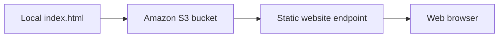

# AWS S3 – Static Portfolio Website Hosting

**Author:** Preethi S  
**Status:** Deployed — browser accessibility demonstrated on 25 November 2026

## Project overview
This hands-on AWS project deploys a personal HTML portfolio using Amazon S3 static website hosting without managing an EC2 server. The bucket has been created and static website hosting is enabled. The portfolio loaded successfully in a browser, as shown in the deployment screenshot.

## Technologies
- Amazon S3 and AWS Management Console
- HTML and CSS (deployed portfolio)
- Git and GitHub (project documentation)
- S3 access control concepts (exact settings not captured)

## Architecture

## Implementation
### Step 1 — Create an S3 bucket (completed)
The AWS console confirms the following bucket configuration:

| Parameter | Value |
|---|---|
| Bucket name | preethibucketdevopsclass |
| Region | Asia Pacific (Mumbai) |
| Region code | ap-south-1 |
| Bucket type | General purpose |
| Creation date | 25 November 2026 |

To reproduce: open the AWS console, navigate to S3, select **Create bucket**, choose a general purpose bucket, enter a globally unique name and select the Mumbai region. Keep public access blocked during initial setup.

### Screenshot — Bucket creation

### Step 2 — Upload portfolio (completed)
Open the bucket, select **Objects → Upload**, and upload `index.html`. Use S3 Standard for frequently accessed website content.

### Step 3 — Enable static website hosting (completed)
Under **Properties → Static website hosting → Edit**, enable hosting and set the index document to `index.html`. Save the settings.

The console confirms hosting is enabled with hosting type **Bucket hosting**.

Website endpoint (browser-tested): [Open portfolio](http://preethibucketdevopsclass.s3-website.ap-south-1.amazonaws.com).

### Step 4 — Configure access (effective read access demonstrated; exact settings not verified)
For a public S3 website endpoint, review bucket-level and account-level Block Public Access settings and allow public read access only to the intended website content. Never upload credentials, private documents or sensitive data. Do not grant public write access. A production alternative is CloudFront with a private S3 REST origin and Origin Access Control (OAC), which supports HTTPS.

### Step 5 — Validate deployment (completed)
Open the website endpoint, verify the page loads, test navigation and capture a screenshot. The S3 website endpoint itself supports HTTP, not HTTPS. The supplied browser screenshot confirms that the portfolio home page loaded over HTTP. Navigation and mobile layout were not independently tested.

## Validation checklist
- [x] General purpose bucket created in Mumbai
- [x] Portfolio HTML uploaded
- [x] Static website hosting enabled
- [x] Website endpoint generated
- [ ] Access configuration verified
- [x] Website tested in browser (home page)
- [x] Bucket creation and hosting configuration screenshots added
- [x] Browser screenshot added

## Troubleshooting notes
| Issue | Checks |
|---|---|
| 403 Access Denied | Review bucket policy, Block Public Access and object access |
| 404 Not Found | Verify object key, case sensitivity and index document name |
| Website not loading | Verify website hosting settings and correct endpoint |
| Unexpected charges | Review storage, requests and data transfer; delete unused resources |

## Interview preparation
**What is Amazon S3?** An object storage service that stores objects in buckets.

**What is an S3 bucket?** A container for objects, created in a selected AWS Region.

**Why S3 for a portfolio?** Static HTML and CSS can be served without maintaining a virtual server.

**Can S3 run backend code?** No. S3 serves static content; backend execution requires another service.

**How do you secure an S3 bucket?** Use least-privilege IAM and bucket policies, Block Public Access where appropriate, encryption and controlled access. For production HTTPS delivery, consider CloudFront with a private S3 origin.

## Learning outcomes
- Completed: created a general purpose S3 bucket in a specified AWS Region and enabled static website hosting.
- Completed: deployed the HTML portfolio and demonstrated browser access.
- Pending verification: exact bucket policy and public access settings, navigation and mobile layout.

## Cost and cleanup
S3 storage, requests and data transfer may incur charges. After testing, remove public access, empty the bucket (including versions if enabled) and delete it if no longer needed.

## References
- [Amazon S3 documentation](https://docs.aws.amazon.com/AmazonS3/latest/userguide/Welcome.html)
- [Static website hosting](https://docs.aws.amazon.com/AmazonS3/latest/userguide/WebsiteHosting.html)

## Author
Preethi S — Technical Support Engineer | Linux & Cloud learner

[GitHub](https://github.com/preethii8)
